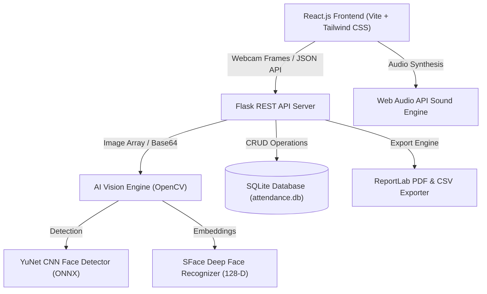

# AI-Based Smart Attendance Management System (FaceTrack.AI Pro)

A modern, responsive, full-stack web application for automated facial recognition attendance management. Built with **React.js**, **Python Flask**, **SQLite/SQLAlchemy**, and deep learning computer vision powered by **OpenCV YuNet** and **OpenCV SFace**.

Inspired by [Hot Face Track Pro](https://hot-face-track-pro.base44.app/).

---

## 🚀 Live Access Link

Once the application is started:
- **Primary React Web Application:** [http://localhost:5173](http://localhost:5173)
- **Unified Production Backend:** [http://localhost:5000](http://localhost:5000)

---

## 🔑 Demo Login Credentials

The system comes pre-seeded with sample students, 14 days of realistic attendance history, and default accounts:

### 1. System Administrator
- **Email/Username:** `admin@smartattendance.edu` or `admin`
- **Password:** `admin123`
- **Role:** Administrator (Full access to all 10 modules, statistics, manual overrides, reports)

### 2. Student Portal
- **Email/Username:** `alex.vance@smartattendance.edu` or `cs2026001`
- **Password:** `student123`
- **Role:** Student (Personal attendance analytics, calendar view, qualification status)

*(Quick 1-click "Autofill" buttons are provided on the Login page for convenience).*

---

## 🏗️ System Architecture



---

## 🌟 Key Modules & Features

### 1. Admin Dashboard
- **KPI Metrics:** Total Enrolled Students, Present Today (On-time vs Late), Absent Today, Real-time Attendance Rate (%).
- **Interactive 7-Day Trend Chart:** Visual bar analytics comparing daily on-time and late attendances.
- **Department Performance Breakdown:** Real-time departmental rates with progress bars.
- **Live Biometric Feed Stream:** Real-time audit log of the most recent check-in activities.

### 2. Live Face Recognition Kiosk
- **Real-time Webcam Scanner:** Continuously analyzes frames with an animated biometric scanline and HUD reticle.
- **Face Detection & Recognition:** Overlays bounding boxes, recognized student name, student ID, and confidence match percentage.
- **Automatic Attendance Marking:** Automatically logs attendance to the database upon positive verification.
- **Anti-Duplicate Protection:** Checks if student already marked today and alerts *"Already Checked In Today at HH:MM:SS"*.
- **Unknown Face Detection:** Red HUD alert with warning indicator for unregistered faces.
- **Celebratory Audio & Visual FX:** Web Audio API chime chime and celebratory particle confetti on verification.

### 3. Biometric Face Registration Studio
- **Multi-angle Capture Wizard:** Captures 5 distinct facial angles (Frontal, Turn Left, Turn Right, Smile, Nod).
- **Auto-Burst Mode:** 1-click automated capture sequence.
- **Deep Feature Extraction:** Generates 128-dimensional embedding vectors stored in the `face_encodings` database table.
- **Profile Photo Auto-Generation:** High-resolution image saved as student avatar.

### 4. Attendance Records
- Comprehensive searchable audit table with date range, student ID, department, and status filters.
- **Manual Entry / Override:** Admin modal dialog to add or correct attendance with administrative notes.
- Individual record deletion and status tracking.

### 5. Attendance Reports & Compliance
- Daily, weekly, monthly, and aggregate reports.
- **Regulatory 75% Alert:** Identifies students falling below the mandatory academic attendance threshold.
- **Certified PDF Export:** Generates official institutional PDF documents with tables and headers using ReportLab.
- **CSV / Excel Export:** 1-click spreadsheet download.

### 6. Student Directory & Management
- Searchable directory of all enrolled students with department and year filters.
- Visual face registration status badges (`Face Enrolled (5 samples)` vs `Face Missing`).
- Edit student information and profile modal.
- Safe cascading deletion.

### 7. Student Registration
- Multi-field enrollment form with validation (Student ID, Name, Email, Phone, Department, Year, Semester, Roll No, Password).
- Seamless 1-click transition to Face Enrollment upon creation.

### 8. Student Personal Portal
- Student-specific attendance percentage gauge.
- Exam qualification eligibility indicator (`Eligible (>75%)` vs `Warning (<75%)`).
- Interactive monthly calendar with color-coded day markers (Green = Present, Amber = Late, Red = Absent).
- Personal attendance history log.

### 9. System Settings
- Configurable institute profile and academic year.
- Operating schedule: Gate opening time, late threshold time (e.g. 09:30 AM), and closing time.
- AI sensitivity slider (Cosine verification threshold 0.30 - 0.65).
- Anti-duplicate and anti-spoofing policies.

---

## 🛠️ Technology Stack

| Layer | Technology |
|---|---|
| **Frontend** | React 19, Vite, Tailwind CSS v4, Lucide Icons, Canvas Confetti |
| **Backend** | Python 3.13, Flask, Flask-CORS, Flask-SQLAlchemy |
| **Database** | SQLite 3 (attendance.db) with relational schema |
| **Face Recognition** | OpenCV Deep Neural Network (`FaceDetectorYN` YuNet + `FaceRecognizerSF` SFace) |
| **Document Generation**| ReportLab (PDF) & Python CSV |
| **Audio Engine** | Web Audio API (Low-latency synthetic audio oscillators) |

---

## 💻 Manual Start Instructions

If running manually via terminal:

1. **Start Backend Server:**
   ```bash
   cd backend
   python app.py
   ```
   *Runs on port 5000*

2. **Start Frontend Dev Server:**
   ```bash
   cd frontend
   npm run dev
   ```
   *Runs on port 5173*
